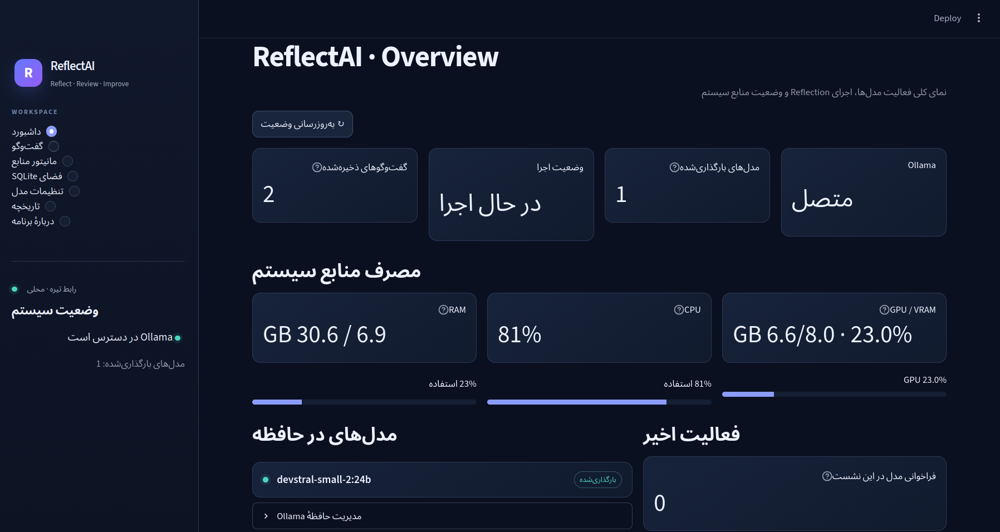
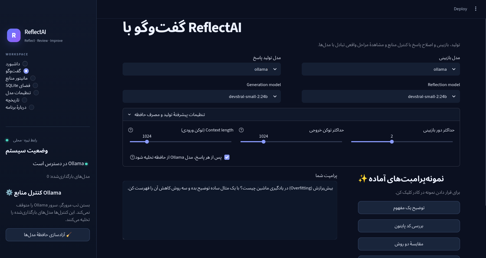
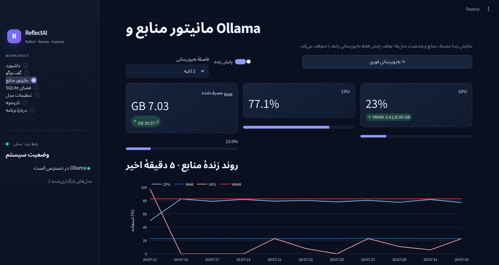
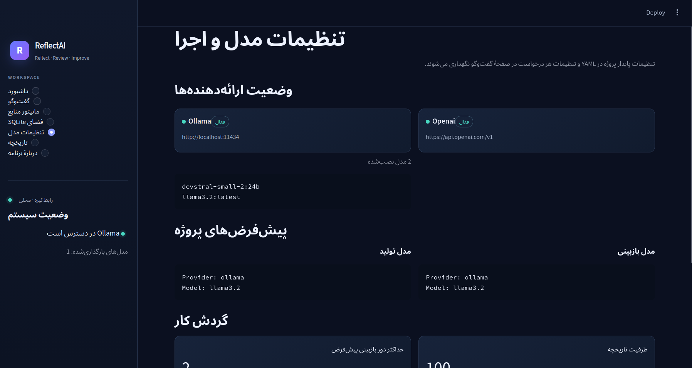
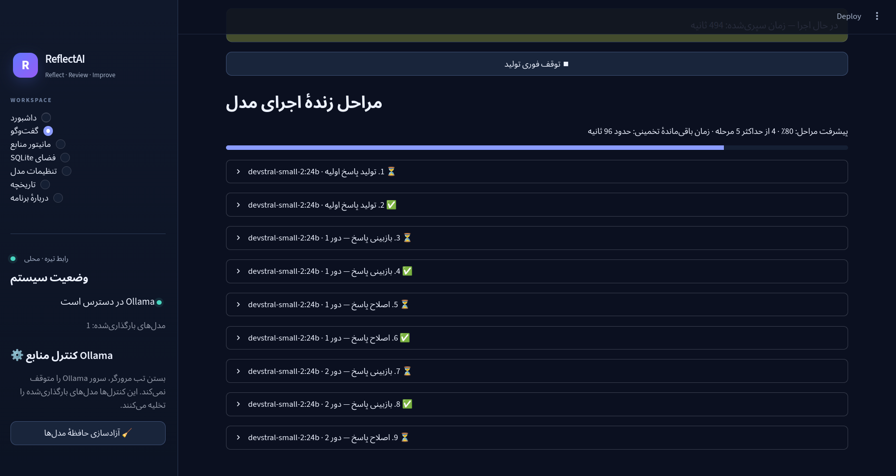

# ReflectAI

**A local-first, multi-provider AI assistant with reflection and data-analysis tools.**

## Screenshots

ReflectAI provides a dark-themed interface for interacting with AI models, reviewing responses, monitoring system resources, and configuring model providers.

### Dashboard

The overview dashboard displays model status, recent activity, and system resource usage.



### Chat Interface

Select separate generation and review models, configure inference parameters, and submit prompts through the chat interface.



### Resource Monitoring

Monitor CPU, RAM, GPU, and VRAM usage while local models are running.



### Model Settings

Configure model providers, default models, and inference settings.



### Live Execution

Inspect the stages of generation, review, and response refinement.



ReflectAI is a Python application that generates an answer with an AI model, optionally reviews and revises that answer with a separately selected model, and provides a SQLite workspace for read-only queries and data visualization. The application uses Streamlit for its graphical interface and supports Ollama and OpenAI-compatible APIs.

## Features

- Select generation and review providers/models independently.
- Connect to local models through Ollama or to an OpenAI-compatible API.
- Run a bounded generate–review–revise workflow (0–5 review rounds).
- Store recent requests and answers in local JSON history.
- Inspect SQLite database schemas and run read-only `SELECT` or `WITH` queries.
- Limit query execution time and result row counts.
- View query results, export them as CSV, and create bar, line, scatter, or histogram charts.
- Configure providers and application settings through YAML files.
- Run automated tests without requiring a live model server or API credentials.

## Architecture Overview

The diagram below shows the main user-facing paths through ReflectAI. The conversation workflow and the data-analysis workflow are separate paths accessed through the Streamlit interface.

```text
                              USER
                                |
                                v
                      STREAMLIT USER INTERFACE
                                |
                   +------------+------------+
                   |                         |
                   v                         v
             CHAT WORKFLOW             DATA WORKSPACE
                   |                         |
                   v                         v
          GENERATION PROVIDER          SQLITE DATABASE
          (Ollama or API)                    |
                   |                         v
                   v                    READ-ONLY SQL
             INITIAL ANSWER                   |
                   |                         v
                   v                    QUERY RESULTS
            REVIEW PROVIDER                   |
          (Ollama or API)          +----------+----------+
                   |               |          |          |
                   v               v          v          v
          REVIEW / FEEDBACK       TABLE      CSV EXPORT  CHARTS
                   |
                   v
         REVISE IF NEEDED
          (bounded rounds)
                   |
                   v
             FINAL ANSWER
                   |
                   v
          LOCAL JSON HISTORY
```

### How the conversation workflow works

1. The user submits a prompt in the Streamlit chat interface.
2. The selected generation provider produces an initial answer.
3. If reflection is enabled, the selected review provider evaluates the answer and returns feedback.
4. ReflectAI can use that feedback to request a revised answer. The number of review rounds is bounded by the configured limit.
5. The final answer is shown to the user and can be saved in local history.

The review step can help identify issues, but it does **not** guarantee that an answer is correct, complete, or safe. The generation and review providers may use the same model or different models, depending on configuration.

### How the SQLite workspace works

1. The user selects the SQLite workspace and supplies a database file path.
2. ReflectAI can inspect the database schema and execute supported read-only queries.
3. The results can be displayed as a table, downloaded as CSV, or visualized using supported chart types.

The SQLite workspace is a separate tool from the chat workflow. It does not automatically mean that the AI agent can access or analyze every database; the user must provide a supported database path and use the available workspace features.

## Requirements

- Python 3.10 or newer.
- For local inference: Ollama installed and running, with a model downloaded.
- For online inference: credentials for the selected OpenAI-compatible service.

## Installation

From the project root, create and activate a virtual environment:

```bash
python -m venv .venv
source .venv/bin/activate
python -m pip install --upgrade pip
python -m pip install -e '.[dev]'
cp .env.example .env
```

On Windows, activate the environment with `.venv\\Scripts\\activate` instead. You can also install dependencies from `requirements.txt` if you do not need an editable package installation.

### Configure Ollama

Make sure Ollama is installed and running, then download a model, for example:

```bash
ollama pull llama3.2
```

Check the endpoint configured in `config/providers.yaml`; the default Ollama endpoint is `http://localhost:11434`.

### Configure an OpenAI-compatible API

Edit `.env` and set the required API key:

```dotenv
OPENAI_API_KEY=your_api_key_here
```

`OPENAI_BASE_URL` can be set when using a compatible endpoint. Keep real credentials in `.env`; never commit this file or publish API keys.

## Run the application

Start the Streamlit interface:

```bash
streamlit run streamlit_app.py
```

Check the command-line entry point and configuration:

```bash
reflectai --version
reflectai --check-config
```

## Run tests

```bash
python -m pytest -v
```

The automated test suite is designed to run without an active model server or API credentials. External provider calls should be mocked where appropriate.

## Configuration files

- `config/providers.yaml` — provider types, model defaults, and endpoint configuration.
- `config/settings.yaml` — application defaults, reflection-round limits, and history retention.
- `.env` — private credentials and local environment overrides. This file should not be committed.

## Project layout

```text
config/                  YAML configuration
src/reflectai/agents/    Writing, SQL, and visualization helpers
src/reflectai/providers/  Ollama and OpenAI-compatible adapters
src/reflectai/reflection/ Generate-review-revise workflow
src/reflectai/security/  SQL validation and execution guardrails
src/reflectai/tools/      SQLite and chart tools
src/reflectai/storage/    Local history storage
src/reflectai/ui/         Streamlit interface and pages
tests/                   Automated tests
docs/                    Architecture, configuration, development, and security notes
examples/                 Example usage
```

## Security and privacy

- Do not commit API keys, `.env`, private databases, or sensitive prompts.
- Local history is stored in `data/history.json`; clear it from the History page or delete the file if needed.
- The SQLite workspace is intended for read-only queries. Its pre-validator is not a complete SQL parser; the read-only connection and SQLite authorizer are important additional safeguards.
- Read-only access does not prevent the app from displaying sensitive data contained in a database you choose to open. Use only database files you are authorized to access.
- This application is intended for local development. Do not expose it publicly without authentication, access controls, and a separate security review.
- AI-generated content may be incorrect. Review important results before relying on them.

## Current limitations

ReflectAI is an extensible starting point, not a fully autonomous general-purpose agent. It does not currently provide guaranteed factual verification, automatic execution of generated code, real-time news collection, stock-price prediction, or built-in support for every database engine. Those capabilities would require additional implementation and testing.

## License

MIT. See `LICENSE`.


## Resource controls and cancellable generation

Run the application with `./run_reflectai.sh` after activating your project environment. Press `Ctrl+C` in that terminal to stop Streamlit; the launcher attempts to unload any models still resident in Ollama. If the browser tab is simply closed, the server process continues until you stop it in the terminal.

The Chat page includes a Stop button, a configurable Ollama context length (`num_ctx`), a maximum output-token setting (`num_predict` for Ollama), and an option to unload models after requests. Lower context/output limits can reduce memory use. The manual “Free Ollama model memory” action unloads models without stopping a separately managed Ollama service.

## Dark dashboard and resource controls

The Streamlit interface uses a dark-only theme configured in `.streamlit/config.toml`. Navigation includes an overview dashboard, chat with an inspectable reflection trace, system/Ollama resource monitor, read-only SQLite workspace, model settings, local history, and About.

The resource monitor reads Linux RAM/CPU data from `/proc` and optionally NVIDIA GPU/VRAM data from `nvidia-smi`. It refreshes on request rather than polling continuously. Ollama model unloading is separate from stopping the Ollama service; stopping the service affects every application connected to that daemon and may require system permissions.


## Live resource monitoring and answer exports

The **مانیتور منابع** page can refresh resource metrics at a configurable interval (1, 2, 5, or 10 seconds), with a live history chart for CPU, RAM, GPU, and VRAM when available. Turning live monitoring off stops periodic UI refreshes; it does not stop Ollama.

Successful final answers are automatically saved as Markdown files under `data/answers/`. The chat page also offers a download button. NVIDIA GPU metrics require a working `nvidia-smi`; unsupported metrics are shown as unavailable.
